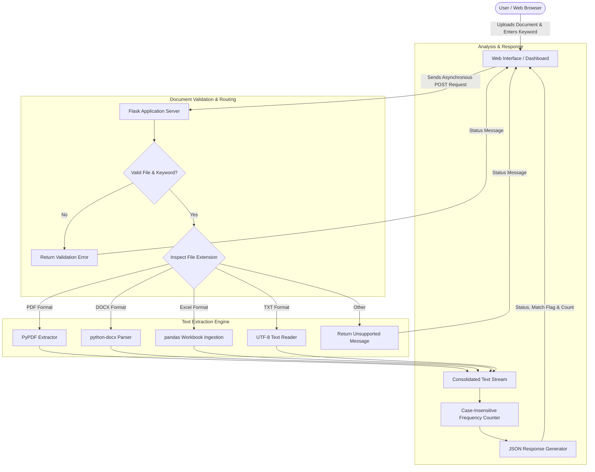

# Document Search & Word Frequency Analyzer

## Project Overview
The **Document Search & Word Frequency Analyzer** is a web-based document intelligence tool designed to inspect, extract, and count the occurrences of specific words or phrases across various document formats. Users can upload standard business and text documents to instantly determine whether a term appears, the total occurrence count, and an analysis response without needing desktop office software installed.

### Key Capabilities
- **Multi-Format Document Parsing**: Ingests multiple standard document formats including PDF (`.pdf`), Word Documents (`.docx`), Excel Spreadsheets (`.xlsx`, `.xls`), and Plain Text (`.txt`).
- **Targeted Frequency Counting**: Performs case-insensitive matching across entire document contents, including multi-page PDFs, complex Word paragraphs, and multi-sheet workbooks.
- **Instant Asynchronous Verification**: Provides real-time feedback with dynamic status messages indicating whether the target term was located and how many times it was detected.
- **Robust Exception Handling**: Detects unsupported file formats, missing files, and empty search inputs with graceful client-side and server-side responses.

---

## System Architecture & Workflow

The solution follows a classic client-server architecture with dedicated text extraction pipelines tailored to each supported file type.

### Architecture Breakdown
1. **Presentation Tier (Client)**: A single-page interactive interface featuring drag-and-drop document upload zones, real-time input fields, and dynamic result display panels.
2. **Application Tier (Server)**: A lightweight Python web server routing incoming multipart requests to format-specific parsing routines.
3. **Extraction & Analysis Tier**:
   - **PDF Parser**: Reads through page tree structures and extracts textual tokens per page into an aggregated document buffer.
   - **DOCX Parser**: Traverses document object model XML structures, extracting paragraph text nodes.
   - **Spreadsheet Parser**: Iterates through workbook sheet names, tabular columns, and records, serializing structured cells into a searchable format.
   - **Text Ingestion**: Reads raw byte buffers and decodes standard UTF-8 text directly.
   - **Occurrence Engine**: Evaluates word frequency against the unified document corpus and returns structured JSON.

---

## Tools and Technologies

### Backend Framework & Languages
- **Python**: Core programming language powering the application logic, document reading, and string processing.
- **Flask**: Lightweight WSGI micro-framework managing routing, file receipt, error handling, and JSON API endpoints.

### Document Processing Libraries
- **PyPDF**: Pure-Python PDF extraction library for accessing and reading text content across PDF pages.
- **python-docx**: Library for manipulating and reading Microsoft Word (.docx) document XML structures.
- **pandas & openpyxl**: High-performance data manipulation package utilized for parsing multi-sheet Excel workbooks.

### Frontend Interface
- **HTML5**: Semantic layout and form scaffolding.
- **Vanilla CSS3**: Modern styling utilizing dark gradients, responsive card layouts, and micro-animations.
- **Vanilla JavaScript**: Handles asynchronous Fetch API calls, file drag-and-drop handling, and real-time DOM updates.

---

## Hosting and Deployment

The application is designed to be cloud-agnostic and can be deployed across various hosting environments.

### 1. Local Hosting
- Runs on a standard local loopback network address with the built-in Flask development server for development and testing.

### 2. Cloud Platform Hosting (PaaS)
- **Render / Railway**: Ideal for automated deployments linked to a Git repository. A production WSGI server (such as Gunicorn) is specified as the start command.
- **PythonAnywhere**: Specialized Python cloud hosting with native WSGI configuration and automated SSL support.
- **Heroku**: Containerized web dyno environment configured with a standard Procfile.

### 3. Containerized & Production Infrastructure (IaaS / Docker)
- **Docker**: Can be packaged into a lightweight container image containing the Python runtime and dependencies.
- **Production Web Server Stack**:
  - **Reverse Proxy**: Nginx to handle incoming HTTPS requests, rate limiting, and SSL termination.
  - **WSGI Application Server**: Gunicorn or uWSGI to run multiple parallel worker processes behind Nginx.
  - **Virtual Private Server (VPS)**: Deployable to cloud providers such as AWS EC2, DigitalOcean Droplets, Google Cloud Compute Engine, or Azure Virtual Machines.
